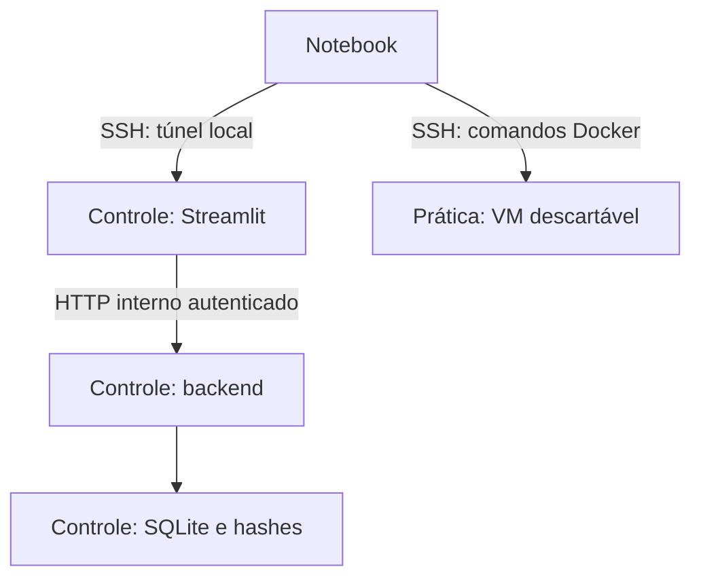

# Docker Security CTF Lab — Etapa 1

Primeira entrega do projeto solicitado: arquitetura, preparação do ambiente e uma base Streamlit executável com três desafios reais de introdução ao Docker. O desenvolvimento segue as etapas do anexo. Esta versão **não é a plataforma completa dos seis níveis**.

## O que funciona nesta entrega

- Painel Streamlit, dashboard, páginas de desafio e histórico.
- Backend separado: SHA-256 de flags aleatórias, tentativas, dicas progressivas, pontos e conquistas.
- Persistência SQLite, backup consistente e reinício de progresso por desafio.
- Três exercícios: filesystem, logs e variáveis de ambiente.
- Provisionamento administrativo das imagens; nenhuma flag real vem no código distribuído.
- Compose separado para controle e prática. Nenhum container monta Docker socket.
- Acesso pelo SSH e pelo túnel local, sem porta 8501 pública.
- Scripts de instalação, inicialização, limpeza e verificação no servidor.
- Testes automatizados e roteiro dos seis níveis.

O módulo Falcon contém o roteiro de preparação e fontes oficiais; não instala o sensor automaticamente nem consulta sua console. Build/Docker Hub, multicontainer, segurança avançada, verificador de estado real e integração Falcon continuam planejados. A UI identifica esses módulos e bloqueia suas submissões.

## Arquitetura



O notebook é a estação de trabalho. A VM de controle mantém respostas e progresso. A VM de prática executa as imagens educacionais em Docker rootless. As VMs devem ser separadas; um estudante com acesso ao daemon de prática não recebe acesso administrativo à VM de controle.

Nesta etapa, os exercícios usam `network_mode: none`. O controle tem uma rede Compose interna e só publica o Streamlit em `127.0.0.1:8501`. A API não publica porta. A comunicação com Docker acontece exclusivamente pelo terminal na VM correspondente.

### Estimativa de recursos

Estimativa de projeto para um estudante, não requisito oficial de CrowdStrike.

| Componente | vCPU | RAM | Disco | Uso |
|---|---:|---:|---:|---|
| VM controle | 2 | 2 GB | 20 GB | Streamlit, API e progresso |
| VM prática, etapa 1 | 2 | 2–4 GB | 30 GB | Três containers leves e builds |
| VM prática, módulos avançados | 2–4 | 4–8 GB | 40–60 GB | Scans, PostgreSQL e pipelines |
| VM extra de alto risco | 2 | 4 GB | 30 GB | Somente se um exercício futuro exigir isolamento adicional |

Ubuntu Server 24.04 LTS, 64 bits. Prefira a mesma arquitetura nas duas VMs inicialmente. Reserve folga durante builds: os limites de execução do Compose não limitam automaticamente processos de build. Consumo real do Falcon deve ser dimensionado com a documentação da versão licenciada.

## Começar

1. Leia [docs/SSH.md](SSH.md): chaves, usuários e aliases.
2. Execute [docs/SETUP.md](SETUP.md): preparação das duas VMs, rootless e provisionamento.
3. Abra o painel pelo túnel e resolva os três exercícios em [docs/CHALLENGES.md](CHALLENGES.md).
4. Consulte [docs/ROADMAP.md](ROADMAP.md) para os critérios de aceitação das próximas etapas.

### Comandos principais, depois da preparação das VMs

**CONTROLE, usuário `ctfctl`, dentro do projeto:**

```bash
bash scripts/start.sh
python3 scripts/check_runtime.py control
```

**PRÁTICA, administrador, depois de transferir o seed privado:**

```bash
sudo python3 scripts/provision_practice.py --user ctf --seed /root/ctf-seed.tar.gz
```

**PRÁTICA, usuário `ctf`, dentro da cópia pública do projeto:**

```bash
docker context use rootless
python3 scripts/check_runtime.py practice
docker compose -p docker-ctf-practice -f practice/compose.yaml ps
```

**NOTEBOOK, depois de configurar o alias `ctf-panel`:**

```bash
ssh -N -o ExitOnForwardFailure=yes -L 127.0.0.1:8501:127.0.0.1:8501 ctf-panel
```

Deixe esse terminal aberto e visite `http://127.0.0.1:8501`. Os comandos SSH funcionam também no PowerShell.

## Arquivos

| Caminho | Responsabilidade |
|---|---|
| `ui/app.py` | Interface Streamlit; só chama endpoints fixos |
| `backend/catalog.py` | Conteúdos e estados ready/planned; nenhuma flag |
| `backend/server.py` | HTTP autenticado e validação de entrada |
| `backend/store.py` | Hashes, transações SQLite, dicas, pontos e auditoria |
| `backend/admin.py` | Backup e reset locais do operador |
| `Dockerfile.api`, `Dockerfile.ui` | Imagens do controle, UID 10001 |
| `compose.yaml` | API e UI, com hardening e banco persistente |
| `practice/compose.yaml` | Três containers de exercícios sem rede |
| `scripts/init_lab.py` | Gera segredos/hashes e seed protegido |
| `scripts/provision_practice.py` | Build dos exercícios no daemon rootless |
| `scripts/install_docker_ubuntu.sh` | Pacotes Docker em VM nova e dedicada |
| `scripts/enable_rootless.sh` | Inicialização do daemon pelo usuário |
| `scripts/start.sh`, `reset.sh`, `cleanup.sh` | Operação com escopo restrito |
| `scripts/check_runtime.py` | Verificações a executar no servidor |
| `tests/` | Testes do backend, API, provisionamento e Streamlit |
| `docs/` | Acesso, configuração, segurança, Falcon e roteiro |

Depois da inicialização, `.private/` contém somente token e hashes; `.delivery/` contém o seed de prática. São artefatos administrativos, gerados em runtime, ignorados pelo Git e pelos builds do controle. Não compartilhe esses diretórios com o estudante.

## Testar

**LOCAL ou SERVIDOR, diretório do projeto:**

```bash
python3 -m unittest discover -s tests -p 'test_backend.py' -v
python3 -m venv .venv
. .venv/bin/activate
pip install -r requirements-ui.txt
python3 -m unittest discover -s tests -p 'test_ui.py' -v
```

Consulte [docs/TEST_RESULTS.md](TEST_RESULTS.md) para o que foi efetivamente executado nesta entrega e o que depende das suas VMs. Os scripts de runtime não são substituídos pelos testes locais.

## Pontuação e confiança

Cada desafio ativo vale 100 pontos. Uma nova dica custa 10 pontos antes da conclusão; no máximo três dicas por exercício. Uma conclusão só soma pontos uma vez. O backend não registra o conteúdo de flags enviadas. Tentativas e resets têm timestamp UTC.

Esta é uma instância individual. Usuários autorizados ao túnel compartilham o mesmo progresso. Para vários estudantes, use implantações separadas nesta versão. Contas, sessões e scoreboards multiusuário precisam de uma etapa adicional.

O administrador que recebe este código pode ler os enunciados, explicações e seed. O isolamento evita exposição acidental e protege o painel do usuário de prática; não constitui mecanismo antifraude contra o dono das duas VMs.

## Operação e recuperação

**CONTROLE, ctfctl:**

```bash
# Backup consistente; exporte também .env, .private/ e .delivery/ para local seguro.
docker compose -p docker-ctf-control exec -T api python3 -m backend.admin backup /data/backup.sqlite3
mkdir -p backups
chmod 700 backups
docker compose -p docker-ctf-control cp api:/data/backup.sqlite3 backups/lab.sqlite3
chmod 600 backups/lab.sqlite3

# Reset somente do progresso desse desafio; mantém histórico e os outros desafios.
docker compose -p docker-ctf-control exec -T api python3 -m backend.admin reset n1-arquivos

# Interrompe o painel, preservando banco e configuração.
bash scripts/cleanup.sh control
```

**PRÁTICA, ctf:**

```bash
bash scripts/reset.sh files
bash scripts/cleanup.sh practice
# Reiniciar depois da limpeza, usando as imagens já provisionadas:
docker compose -p docker-ctf-practice -f practice/compose.yaml up -d --pull never
```

Para apagar explicitamente o progresso do controle, `bash scripts/cleanup.sh control --erase-progress` remove **apenas** o volume desta implantação. Nunca use esse argumento antes de salvar um backup desejado.

Não recrie os segredos para reiniciar containers. O backend recusa abrir um banco cujo seed não corresponde aos hashes configurados. Recuperação completa: restaure os mesmos segredos, seed e backup seguindo [docs/RECOVERY.md](RECOVERY.md).

## Dependências e fontes

A API usa a biblioteca padrão Python; o Streamlit está fixado na versão testada em `requirements-ui.txt`. As bases Docker têm tags de linha de versão; não foram fixadas por digest nesta etapa. Antes de reprodutibilidade rigorosa/produção, registre digests e congele também as dependências transitivas.

Fontes oficiais consultadas em 10/10/2026 estão em [docs/SOURCES.md](SOURCES.md).
